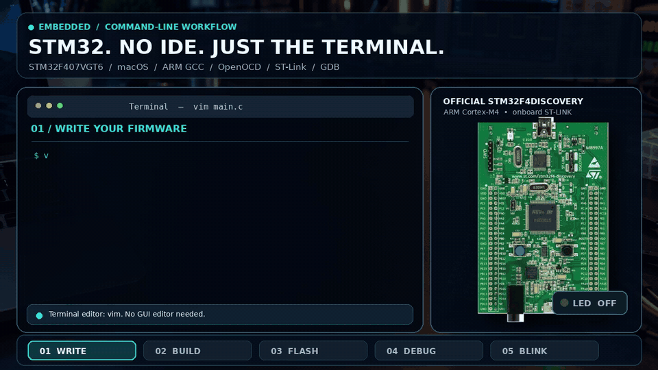

# Programming STM32 Without an IDE. Just the Terminal. ⚡

**A complete, step-by-step macOS Terminal guide to bare-metal programming the STM32F407VGT6 using ARM GCC, OpenOCD, onboard ST-LINK and GDB.** No STM32CubeIDE, graphical editor, HAL, or external LED required.



> **About the animation:** The MP4 are illustrative demonstrations, not a recording of a real hardware programming session. The C, assembly, linker and Makefile source code are included below. **Real-board flashing/debugging have not been verified in this environment.**

## What you will build

A minimal bare-metal firmware that blinks **LD4 (green LED on PD12)** on the official STM32F4 Discovery board, alternating **500 ms ON / 500 ms OFF**. Everything—code editing, compiling, flashing and debugging—is done from macOS Terminal.

| Stage | Tool | Result |
| --- | --- | --- |
| 1. Write firmware | `nano` or `vim` | Edit `src/main.c` |
| 2. Compile and link | ARM GCC + `make` | Generate `.elf`, `.bin`, `.hex` |
| 3. Flash and verify | OpenOCD + onboard ST-LINK | Write firmware over SWD |
| 4. Debug | GDB + OpenOCD | Break at `main()`, step, inspect registers |
| 5. Run | STM32F407VGT6 | Green LD4 LED blinks |

## Requirements (before you begin)

- **Board:** [STM32F4DISCOVERY / STM32F407G-DISC1](https://www.st.com/en/evaluation-tools/stm32f4discovery.html) with an STM32F407VGT6 Cortex-M4 MCU.
- **Cable:** a **data-capable Micro-USB** cable (USB-C adapter/hub may be needed for your Mac).
- **Computer:** an Intel or Apple Silicon Mac with Terminal and an internet connection for the initial tool installation.
- **Debug connection:** use the board's **onboard ST-LINK USB port**, *not* the separate USB OTG connector.

The Discovery kit includes an onboard debugger/programmer. **You do not need an external ST-LINK adapter, SWD wires, breadboard or external LED.** The version of onboard ST-LINK differs between older and newer board revisions.

---

## Step-by-step guide: first blink on macOS

### Step 1 — Open Terminal and check Homebrew

Open macOS **Terminal** and enter:

```bash
brew --version
```

If you see `command not found: brew`, install Homebrew using the instructions at **https://brew.sh/**, then close/reopen Terminal (or follow Homebrew's PATH instructions). On a fresh Mac you may also need Apple's Command Line Tools:

```bash
xcode-select --install
```

If the tools are already installed, macOS may tell you so; that's fine.

**Expected result:** `brew --version` shows an installed Homebrew version.

### Step 2 — Install ARM compiler, debugger and flashing tools

Run this single Homebrew command:

```bash
brew install arm-none-eabi-gcc arm-none-eabi-gdb open-ocd
```

Verify the commands are available:

```bash
arm-none-eabi-gcc --version
arm-none-eabi-gdb --version
openocd --version
make --version
```

**Expected result:** each command prints version information, rather than `command not found`.

> Toolchain packages: [ARM GCC](https://formulae.brew.sh/formula/arm-none-eabi-gcc), [ARM GDB](https://formulae.brew.sh/formula/arm-none-eabi-gdb), [OpenOCD](https://formulae.brew.sh/formula/open-ocd).

### Step 3 — Get the repository

If you've already downloaded this project as a ZIP, extract it, open Terminal, and use `cd` to enter the extracted `stm32f407-terminal-baremetal` folder. For example, if extracted into Downloads:

```bash
cd ~/Downloads/stm32f407-terminal-baremetal
```

Or, after the project is uploaded to GitHub, clone it instead (replace `YOUR_USERNAME`):

```bash
git clone https://github.com/YOUR_USERNAME/stm32f407-terminal-baremetal.git
cd stm32f407-terminal-baremetal
```

To confirm you're in the correct folder:

```bash
pwd
ls
make check-tools
```

**Expected result:** `ls` lists `Makefile`, `README.md`, `src`, `linker`, `scripts`, `docs`; `make check-tools` shows `[OK]` for the required commands.

### Step 4 — Inspect or edit the C firmware (Terminal only)

The repository already includes working example source in `src/main.c`; **you do not need to write it from scratch**. Open it in a terminal-based editor:

```bash
nano src/main.c
```

Or use Vim:

```bash
vim src/main.c
```

The firmware enables GPIOD, configures **PD12** as an output, and uses **SysTick** to time 500 ms LED toggles.

**Nano shortcut:** `Ctrl+O` then `Enter` saves; `Ctrl+X` exits. **Vim shortcut:** press `Esc`, type `:wq`, then `Enter` to save and quit. To exit without saving in Vim, use `:q!`.

To inspect the main logic without editing it:

```bash
cat src/main.c
```

### Step 5 — Compile the firmware with ARM GCC

From the repository root, run:

```bash
make clean
make
```

The Makefile automatically compiles `src/main.c` and `src/startup_stm32f407.S`, then links them using `linker/STM32F407VG_FLASH.ld`.

See the resulting firmware:

```bash
ls -lh build/
make size
```

**Expected files:**

```text
build/stm32f407_blink.elf   # executable + symbols used by GDB/OpenOCD
build/stm32f407_blink.bin   # raw flash binary
build/stm32f407_blink.hex   # Intel HEX firmware
```

**Expected result:** the build ends without compiler/linker errors, and `make size` prints memory usage. Actual byte counts vary with compiler versions.

### Step 6 — Connect the STM32F4 Discovery board

1. Make sure the board is resting on a nonconductive surface.
2. Plug the Micro-USB data cable into the **onboard ST-LINK USB connector** on the board.
3. Connect the other end to your Mac or a reliable USB hub.
4. Verify that the board powers up (normally the **red LD2 power LED** turns on).
5. The on-board debugger communicates with the STM32F407 using SWD; no additional wiring is needed.

You can optionally inspect attached USB devices using macOS Terminal:

```bash
system_profiler SPUSBDataType | grep -i -A 10 'ST-LINK'
```

**Expected result:** macOS detects an ST-LINK device. Depending on macOS/USB reporting, its name may appear differently; an empty `grep` result is not by itself proof of a hardware fault.

### Step 7 — Flash the firmware with OpenOCD and ST-LINK

With the board connected, run:

```bash
make flash
```

This runs OpenOCD with its ST-LINK interface and STM32F4 target configuration, programming the generated ELF, **verifying it** and **resetting the target**. Under the hood, the equivalent OpenOCD command is:

```bash
openocd -f interface/stlink.cfg -f target/stm32f4x.cfg \
  -c 'program build/stm32f407_blink.elf verify reset exit'
```

**Expected result:** OpenOCD reports that the ST-LINK/STM32 target was detected, that programming completed, and that verification succeeded. The specific messages depend on the OpenOCD/ST-LINK firmware versions.

> **Important:** `make flash` writes to the connected MCU. Use it only when the target is your intended STM32F407 Discovery board and you are happy to replace its current firmware.

### Step 8 — Check the LED blink

Once flashing completes and the target resets, look for the **green LD4 LED** on the STM32F4 Discovery board. It should repeat:

```text
Green LD4:  ON (500 ms) → OFF (500 ms) → ON (500 ms) → ...
GPIO:       PD12
```

This is **not** the solid red power LED. If the green LED doesn't blink, refer to [Troubleshooting](docs/troubleshooting.md) and check that OpenOCD verified the firmware successfully.

### Step 9 — Debug with GDB (two Terminal windows)

For debugging, OpenOCD must remain running as a GDB server. Use two Terminal windows:

**Terminal window 1 — start OpenOCD:**

```bash
cd /path/to/stm32f407-terminal-baremetal
make debug-server
```

Leave this Terminal window open. OpenOCD normally listens for GDB on **localhost port 3333**.

**Terminal window 2 — connect GDB:**

```bash
cd /path/to/stm32f407-terminal-baremetal
make gdb
```

Replace `/path/to/...` with the actual project location. For example, use `~/Downloads/stm32f407-terminal-baremetal` if that's where you extracted it.

The provided `scripts/debug.gdb` connects to OpenOCD, resets/halts the target, then stops at a temporary breakpoint at `main()`.

At the `(gdb)` prompt, try:

```gdb
list                     # show source around current line
next                     # execute next C source line
info registers           # inspect Cortex-M4 registers
x/4wx 0x40020C00         # read GPIOD peripheral registers
continue                 # resume firmware execution
```

**Expected result:** GDB connects to the target, stops at `main()`, lets you inspect state, then resumes the LED program. The LED may pause while the CPU is halted; this is normal.

When finished, enter `quit` in GDB, then press `Ctrl+C` in **Terminal window 1** to stop OpenOCD.

### Step 10 — Rebuild and repeat

Change the firmware, then rebuild and flash it again:

```bash
nano src/main.c
make
make flash
```

For example, change `#define BLINK_MS 500UL` to `1000UL` to make the green LED stay on for one second and off for one second. The project now demonstrates the entire firmware cycle without opening an IDE.

---

## Common issues and quick fixes

| Problem | First thing to try |
| --- | --- |
| `brew: command not found` | Install Homebrew from [brew.sh](https://brew.sh/) and configure your shell PATH |
| `arm-none-eabi-gcc: command not found` | Repeat `brew install arm-none-eabi-gcc arm-none-eabi-gdb open-ocd` |
| `No rule to make target ...` | Run `pwd` and `ls`; make sure you're in the repository root |
| OpenOCD can't find ST-LINK | Use the correct on-board ST-LINK USB connector and a data cable |
| OpenOCD `unable to open ...` | Close other debugger sessions; check connection and USB permissions |
| `localhost:3333` connection refused | Start `make debug-server` in the first Terminal; leave it running |
| Green LED stays off | Verify `make flash` completed; look for **green LD4**, not red LD2 |
| `arm-none-eabi-gdb` won't launch | Confirm installation/version and inspect the macOS security prompt |

For additional information: [full troubleshooting](docs/troubleshooting.md) · [sample terminal output](docs/terminal-session.md) · [board notes](docs/board-notes.md).

## How the bare-metal code works

- **Startup:** the flash vector table provides the initial stack pointer and `Reset_Handler`; assembly initializes `.data` and `.bss` before calling `main()`.
- **GPIO:** `RCC_AHB1ENR` enables GPIOD; the firmware configures **PD12** as a push-pull output.
- **Timer:** the default reset system clock is **16 MHz HSI**; SysTick creates 1 ms interrupts, and the code waits 500 ms between LED state changes.
- **Memory:** the linker script puts code at flash address `0x08000000` (1 MiB) and data in SRAM starting at `0x20000000` (192 KiB). The separate CCM RAM area is unused.
- **Debugging:** OpenOCD controls the target through onboard ST-LINK, and GDB connects to the OpenOCD GDB server.

This is a small educational example, not a production-grade firmware framework; it intentionally omits PLL setup, RTOS, fault diagnostics, and peripheral libraries.

## Make commands cheat sheet

| Command | What it does |
| --- | --- |
| `make check-tools` | Check installed compiler, GDB, OpenOCD, tools |
| `make` | Build `.elf`, `.bin`, and `.hex` |
| `make clean` | Delete generated `build/` files |
| `make flash` | Program + verify + reset over onboard ST-LINK |
| `make debug-server` | Keep OpenOCD running on port 3333 |
| `make gdb` | Attach GDB to the target via OpenOCD |
| `make size` | Print executable data/code sizes |
| `make disasm` | Generate source/assembly disassembly listing |

## Project folder structure

```text
stm32f407-terminal-baremetal/
├── README.md                       # THIS step-by-step tutorial
├── Makefile                        # ARM GCC build, flash, debug commands
├── LICENSE
├── .gitignore
├── .gitattributes
├── src/
│   ├── main.c                      # LD4 / PD12 LED example
│   ├── stm32f407.h                 # minimum MCU register definitions
│   └── startup_stm32f407.S         # vector table and reset handler
├── linker/
│   └── STM32F407VG_FLASH.ld        # flash/SRAM memory layout
├── scripts/
│   ├── check-tools.sh              # tool availability checks
│   └── debug.gdb                   # connect to OpenOCD and break at main
└── docs/
    ├── board-notes.md
    ├── terminal-session.md
    ├── troubleshooting.md
    ├── linkedin-caption.md
    ├── stm32-workflow.gif
    └── stm32-workflow.mp4
```

## Publish this project on GitHub (repository owner)

If you downloaded this project ZIP and want to share the code in your LinkedIn description:

1. Create a **public, empty** GitHub repository named `stm32f407-terminal-baremetal` at [github.com/new](https://github.com/new). Don't initialize it with a second README, license or `.gitignore`.
2. Extract the downloaded ZIP and open its folder in Terminal.
3. Run these commands, changing `YOUR_USERNAME` to your GitHub username:

```bash
cd ~/Downloads/stm32f407-terminal-baremetal
git init
git add .
git commit -m "Initial STM32 terminal-only bare-metal project"
git branch -M main
git remote add origin https://github.com/YOUR_USERNAME/stm32f407-terminal-baremetal.git
git push -u origin main
```

GitHub may prompt you to authenticate. If Git refuses to commit because your identity isn't configured, set `git config --global user.name "Your Name"` and `git config --global user.email "you@example.com"` (use your own values), then retry.

4. Open `https://github.com/YOUR_USERNAME/stm32f407-terminal-baremetal` and verify the README and animation appear.
5. Put the repository URL in the description of your LinkedIn post. The included [LinkedIn caption](docs/linkedin-caption.md) offers a starting point.

## Reference material

- [STMicroelectronics STM32F4 Discovery board](https://www.st.com/en/evaluation-tools/stm32f4discovery.html)
- [OpenOCD documentation](https://openocd.org/doc/html/)
- [GNU Arm Embedded GCC (Homebrew)](https://formulae.brew.sh/formula/arm-none-eabi-gcc)
- [GNU Arm Embedded GDB (Homebrew)](https://formulae.brew.sh/formula/arm-none-eabi-gdb)
- [Sample terminal session](docs/terminal-session.md)
- [LinkedIn post caption](docs/linkedin-caption.md)

## Validation and license

The repository contains real source code and build configuration. A Cortex-M4-oriented compile/link check was performed previously, but **this environment has not connected to or flashed an STM32F4 Discovery board**. Actual build results can also vary by installed ARM GCC/OpenOCD versions. Verify the full workflow on your own board before describing it as a completed physical demonstration.

Distributed under the **MIT License**; see [LICENSE](LICENSE).
# stm32f407-terminal-baremetal

